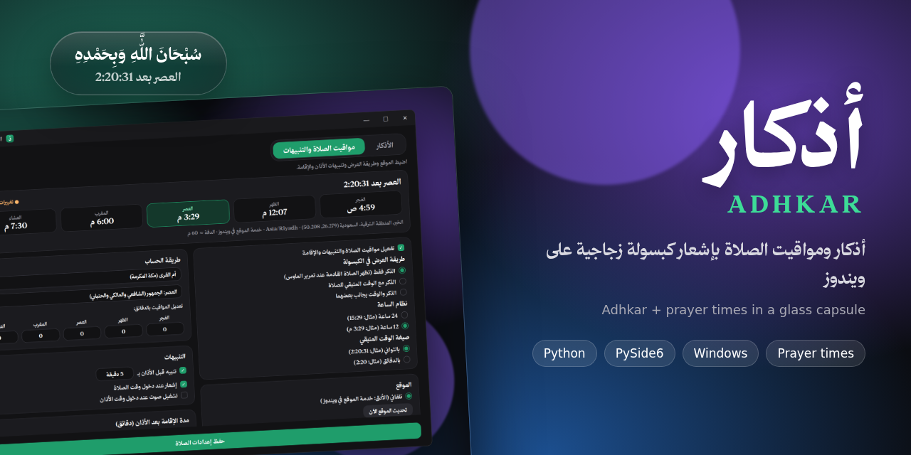
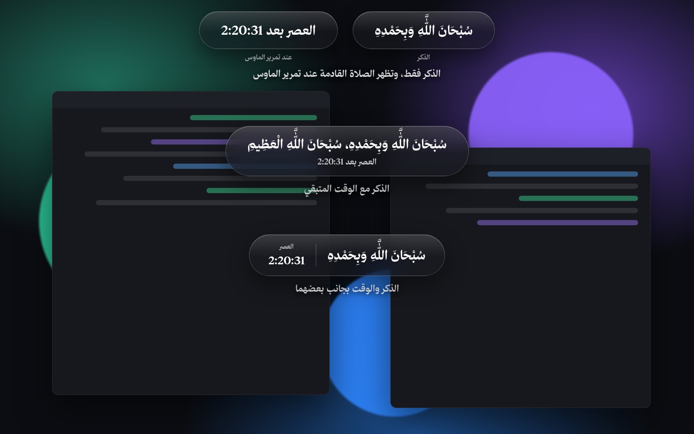
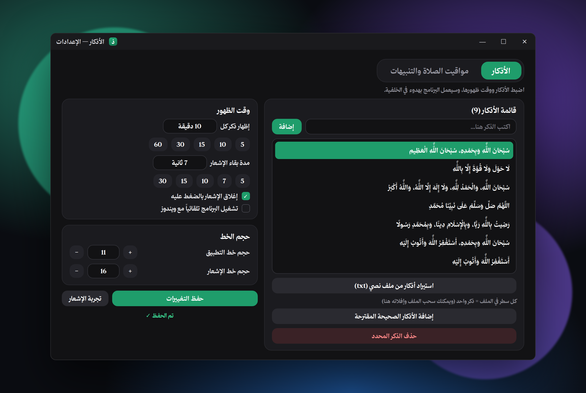
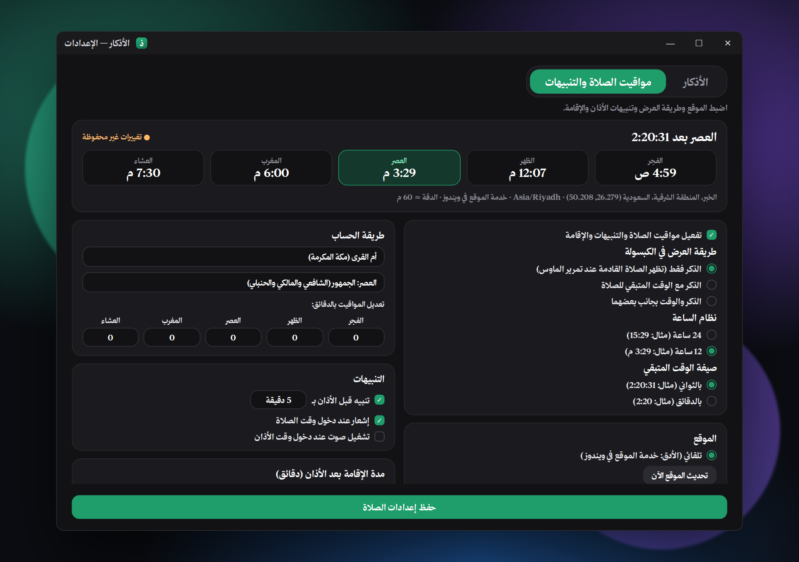

<div dir="rtl">

<div align="center">



# أذكار | Adhkar

**تطبيق لسطح مكتب ويندوز يعرض لك أذكاراً قصيرة صحيحة ومواقيت الصلاة في إشعار كبسولة زجاجية بنمط iOS.**

[](../../actions/workflows/tests.yml)

العربية · [English](README.md)

</div>

---

## الفكرة

ننسى الأذكار ووقت الصلاة القادمة كثيراً ونحن نعمل على الجهاز. التطبيق يعمل بهدوء في الخلفية، وكل فترة تحددها تنزل من أعلى الشاشة كبسولة زجاجية صغيرة فيها ذكر قصير ثم تختفي، ولا تسحب التركيز من النافذة التي تعمل عليها.

## المميزات

### الأذكار
- **إشعار كبسولة زجاجية:** بدون إطار وبخلفية ضبابية، تنزل من منتصف أعلى الشاشة وتصعد بحركة سلسة، ولا تأخذ التركيز.
- **تتحكم بالوقت:** الفاصل بين الإشعارات (من 1 إلى 1440 دقيقة) ومدة بقاء الإشعار (من 2 إلى 120 ثانية).
- **الإغلاق بالنقر**، أو عطّله فتمرّ نقراتك إلى النافذة التي خلفه.
- **أذكارك أنت:** أضف واحذف، أو استورد ملف `.txt` كل سطر فيه ذكر (UTF-8 وUTF-16 وWindows-1256، ويُتجاهل المكرر)، أو اسحب الملف وأفلته على النافذة.
- **أذكار جاهزة:** تسعة أذكار قصيرة من القرآن والسنة ومراجعها أدناه.
- **حجم خط منفصل** للواجهة وللإشعار.

### مواقيت الصلاة (جديد)
- **تُحسب محلياً بدون إنترنت:** الصلوات الخمس تُحسب على جهازك من إحداثياتك (سبع طرق حساب، وعصر جمهور أو حنفي، وتعديل يدوي حتى ±60 دقيقة لكل صلاة).
- **ثلاثة أوضاع للكبسولة** تتبدل بدون إعادة تشغيل:
  1. *الذكر فقط:* مرّر الماوس فتظهر الصلاة القادمة والوقت المتبقي.
  2. *الذكر مع الوقت:* العدّاد تحت الذكر.
  3. *بجانب بعضهما:* الذكر في جهة، واسم الصلاة والعدّاد في الجهة الأخرى.
- **صيغ العرض:** ساعة 24 أو 12 (بصيغة 3:29 م)، والوقت المتبقي **بالثواني (2:20:31)** أو **بالدقائق (2:20)**.
- **دورة الصلاة:** تنبيه قبل الأذان (5 دقائق افتراضياً)، وإشعار عند الأذان، ثم **عدّاد إقامة بمدة مستقلة لكل صلاة**، ثم الصلاة التالية. لا تتكرر الإشعارات، وتبقى حالتها بعد إعادة التشغيل، وما حلّ موعده أثناء إغلاق التطبيق أو السكون يُتجاوز بدل أن تظهر إشعارات قديمة دفعة واحدة.
- **صوت أذان اختياري:** تختار ملفك بنفسك (WAV أو MP3 أو WMA)، ومعطّل افتراضياً.
- **موقع أدق:**
  - *التلقائي* يعتمد على **خدمة الموقع في ويندوز** (Wi-Fi/GPS) ويعرض الدقة. وإن لم تتوفر يُعرض تقدير تقريبي من الإنترنت، ولا يستبدل موقعاً محفوظاً بصمت.
  - *اليدوي:* ابحث عن مدينتك أو أدخل الإحداثيات بدقة.
- **تبويبان:** «الأذكار» و«مواقيت الصلاة والتنبيهات»، مع شريط حي بأوقات اليوم والصلاة القادمة مظللة.
- **الخانات الرقمية والقوائم المنسدلة لا تتأثر بعجلة الماوس،** فلا تتغير قيمة بالخطأ عند تمرير الصفحة.
- **يعمل في الخلفية:** إغلاق النافذة يخفيها في الـ Tray (وتعرض أيقونته الصلاة القادمة). وخيار التشغيل مع ويندوز.

## لقطات الشاشة


<p align="center">
  
</p>
<p align="center">
  
  
</p>

## التحميل

حمّل أحدث مثبّت (`Adhkar_Setup.exe`) من صفحة [Releases](../../releases).

> الملف غير موقّع رقمياً، فقد يعرض ويندوز تحذير SmartScreen. اختر **More info ثم Run anyway**.

## التشغيل من الكود

المتطلبات: ويندوز وPython 3.10 أو أحدث (طُوّر واختُبر على 3.12).

```bash
pip install -r requirements.txt
python adhkar_app.py
```

### الخط

تستخدم الواجهة خط ثمانية. ملف الخط غير مرفق في المستودع: ضع ملف `.otf` أو `.ttf` في مجلد `fonts/` وسيحمّله التطبيق تلقائياً، وبدونه يستخدم Segoe UI. راجع ترخيص الخط قبل إعادة توزيعه.

## البناء

```bash
build.bat              # يبني dist\Adhkar.exe (PyInstaller)
build_installer.bat    # يبني الملف التنفيذي ثم installer_output\Adhkar_Setup.exe (Inno Setup 6)
```

يستطيع `build_installer.bat` تثبيت Inno Setup عبر `winget` إذا لم يجده. ويضمّن البناء حزمة `tzdata` لتعمل المناطق الزمنية داخل الـ exe.

## الاختبارات

```bash
python -m unittest discover -s tests -v
```

169 اختباراً تغطي الحساب (قورن بجداول منشورة)، والعدّاد ودورة الإقامة، ومنع تكرار الإشعارات، والسكون وتغيير الساعة، وتحليل الموقع، وصيغ العرض، وحفظ الإعدادات، ومنطق الواجهة (بأدوات مزيّفة ودون واجهة رسومية). أما الرسم والحركة وتمرير الماوس والصوت فتُتحقق منها يدوياً: انظر [docs/TESTING_WINDOWS.md](docs/TESTING_WINDOWS.md).

لمشاهدة دورة صلاة كاملة بدون انتظار، شغّل التطبيق بساعة وهمية ومجلد بيانات معزول:

```bat
test_mode.bat 2026-10-11T15:23:00+03:00
```

## استيراد الأذكار من ملف نصي

ضع في كل سطر ذكراً واحداً:

```text
سُبْحَانَ اللَّهِ وَبِحَمْدِهِ
الْحَمْدُ لِلَّهِ رَبِّ الْعَالَمِينَ
اللَّهُ أَكْبَرُ
```

ثم اضغط «استيراد أذكار من ملف نصي» (أو أفلت الملف على النافذة) واضغط «حفظ التغييرات». يوجد مثال في [`sample/adhkar_sample.txt`](sample/adhkar_sample.txt).

## البيانات والخصوصية

تُحفظ الإعدادات في `%APPDATA%\Adhkar\data.json` وحالة الإشعارات في `prayer_state.json` بجانبه. المواقيت تُحسب محلياً. ولا يتصل التطبيق بالإنترنت **إلا عندما تطلب ذلك** (الموقع التلقائي أو البحث عن مدينة) وبهذه الخدمات:

| الغرض | الخدمة |
|---|---|
| الموقع التلقائي | خدمة الموقع في ويندوز (مايكروسوفت)، و`ipwho.is` / `ipapi.co` كحل احتياطي تقريبي |
| البحث عن المدن والمنطقة الزمنية | [Open-Meteo](https://open-meteo.com) |
| اسم المدينة من الإحداثيات | [OpenStreetMap Nominatim](https://nominatim.org) |

## الأذكار الجاهزة ومراجعها

| الذكر | المرجع |
|---|---|
| سبحان الله وبحمده، سبحان الله العظيم | البخاري 6406، مسلم 2694 |
| لا حول ولا قوة إلا بالله | البخاري 6409، مسلم 2704 |
| سبحان الله، والحمد لله، ولا إله إلا الله، والله أكبر | مسلم 2137 |
| اللهم صل وسلم على نبينا محمد | مسلم 408 (فضل الصلاة على النبي ﷺ) |
| رضيت بالله ربا، وبالإسلام دينا، وبمحمد رسولا | أبو داود 1529، مسلم 1884 |
| سبحان الله وبحمده، أستغفر الله وأتوب إليه | مسلم 484 |
| أستغفر الله وأتوب إليه | البخاري 6307 |
| لا إله إلا الله وحده لا شريك له، له الملك وله الحمد وهو على كل شيء قدير | البخاري 3293، مسلم 2691 |
| حسبي الله لا إله إلا هو عليه توكلت وهو رب العرش العظيم | التوبة: 129 |

المراجع للتسهيل فقط، فيُرجى التأكد منها في مصادر الحديث الموثوقة.

## ملاحظات على مواقيت الصلاة

- المعادلات الفلكية تتبع طريقة [PrayTimes.org](http://praytimes.org) المعروفة، مُعاد كتابتها بلغة Python.
- قد يختلف الوقت دقيقة أو دقيقتين عن تقويم مسجدك المحلي؛ استخدم تعديل كل صلاة للمطابقة.
- يضيف تقويم أم القرى 30 دقيقة للعشاء في رمضان، وهذا لا يُطبَّق تلقائياً: اجعل تعديل العشاء +30 خلال رمضان.
- مدد الإقامة الافتراضية تقريبية وقابلة للتعديل، وليست مواقيت إقامة رسمية.

## التقنيات

Python · PySide6 (Qt for Python) · PyInstaller · Inno Setup · `unittest`

## الترخيص

[MIT](LICENSE)

</div>
